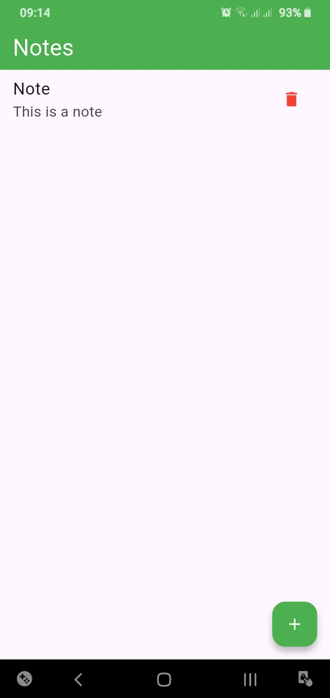
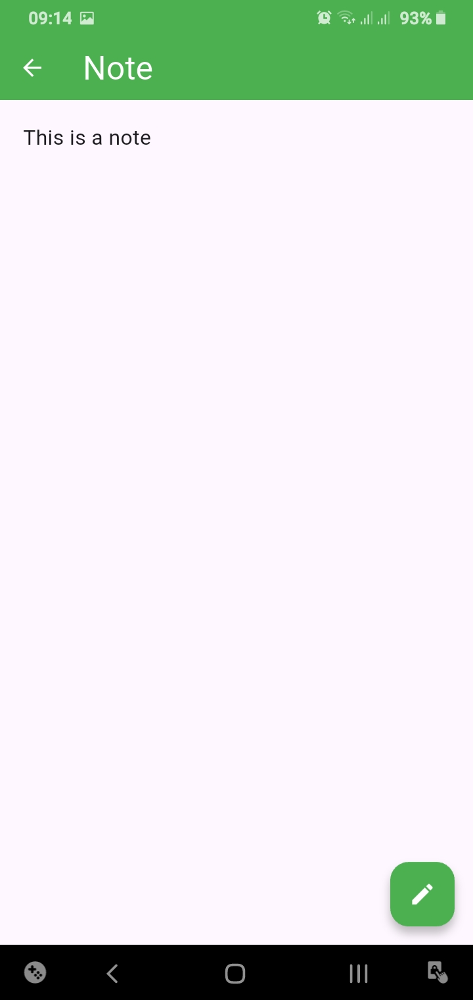
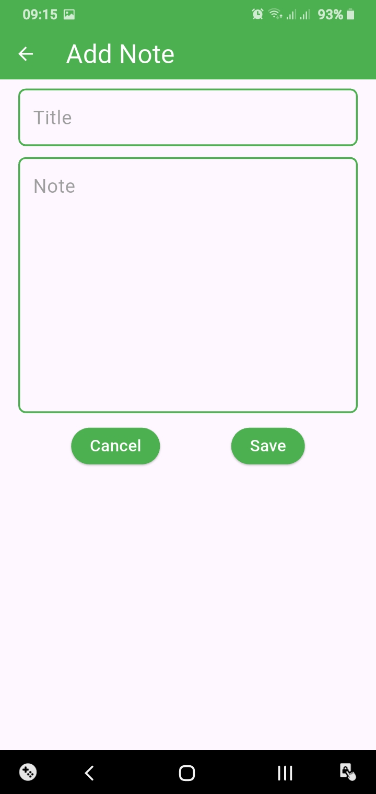
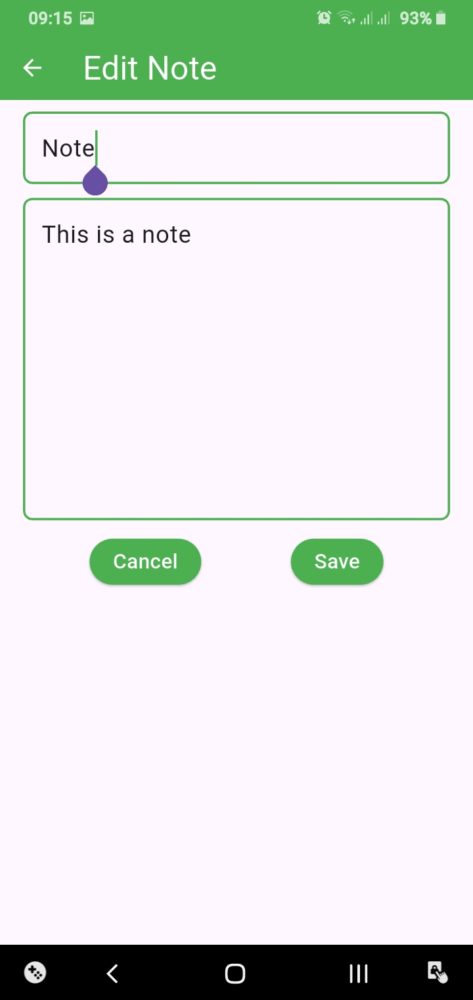

# Notepad

A simple note-taking and task management application built with Flutter and Hive.

## Features

### Notes
- Create notes
- Edit notes
- Delete notes
- Scrollable note page
- Confirmation dialog before deleting
- Input validation

### Tasks
- Create tasks
- Edit task titles
- Delete individual todos
- Add todos to tasks
- Edit todos
- Mark todos as completed or incomplete
- Visual indication of completed todos
- Display completed todo count

### General
- Local storage with Hive
- Light and dark theme support

## Screenshots

| Home Page | Note Page |
|---|---|
|  |  |

| Add Note Page | Edit Note Page |
|---|---|
|  |  |

## Technologies

- Flutter
- Dart
- Hive